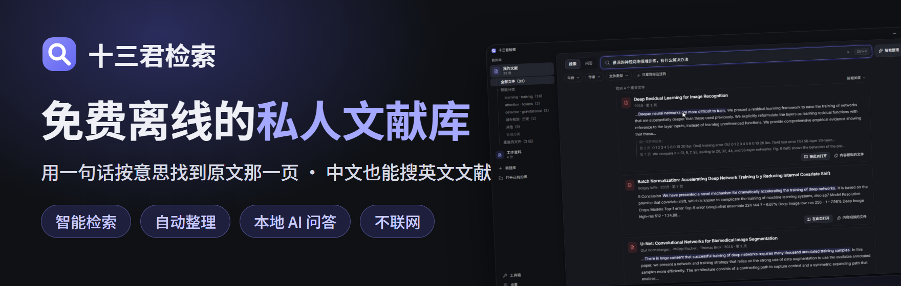
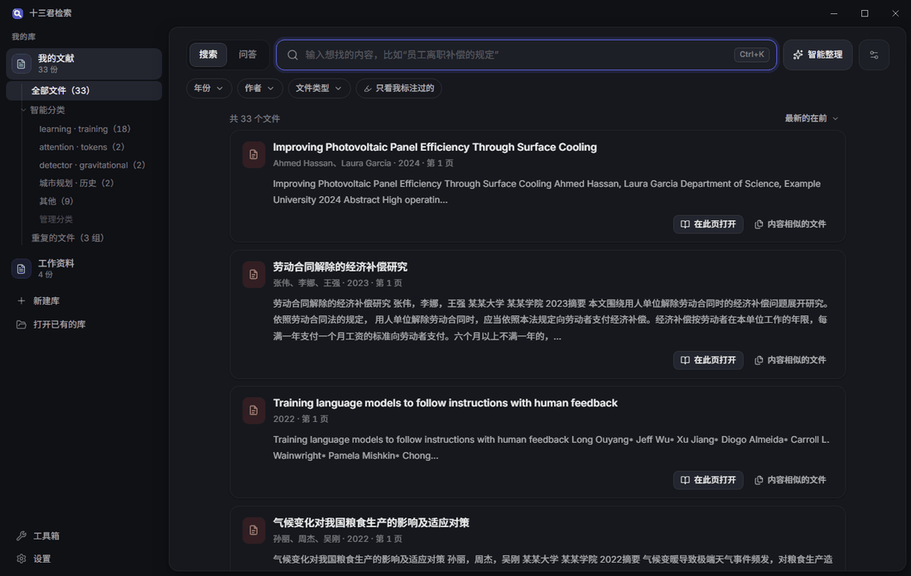
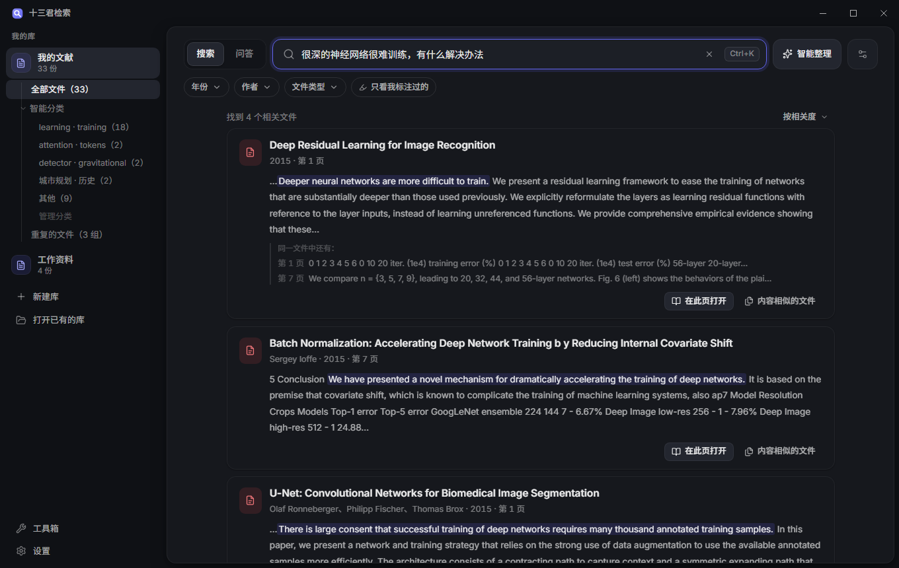
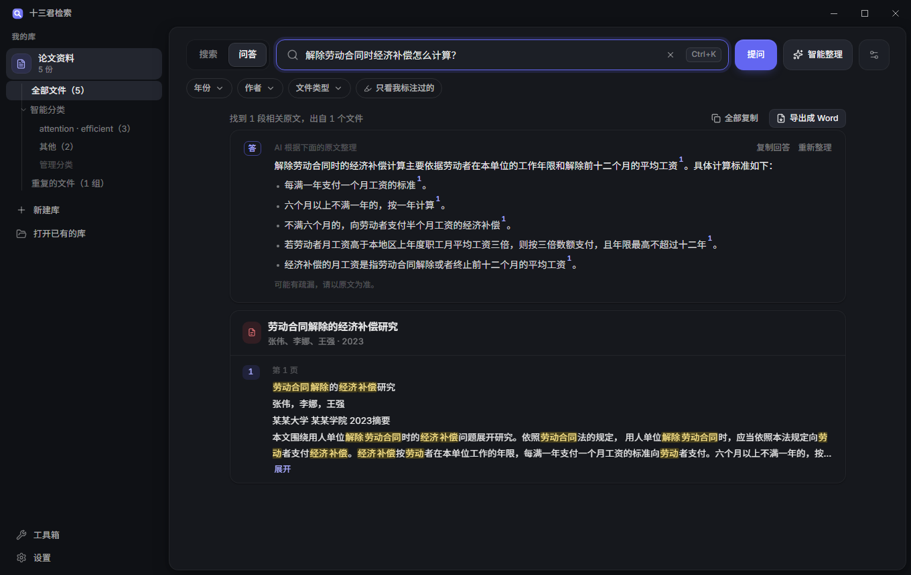
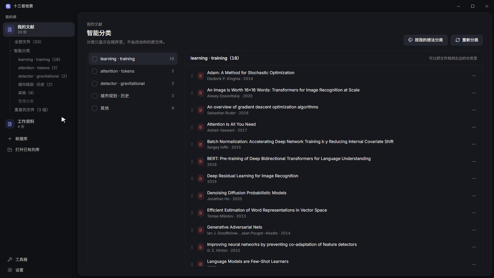
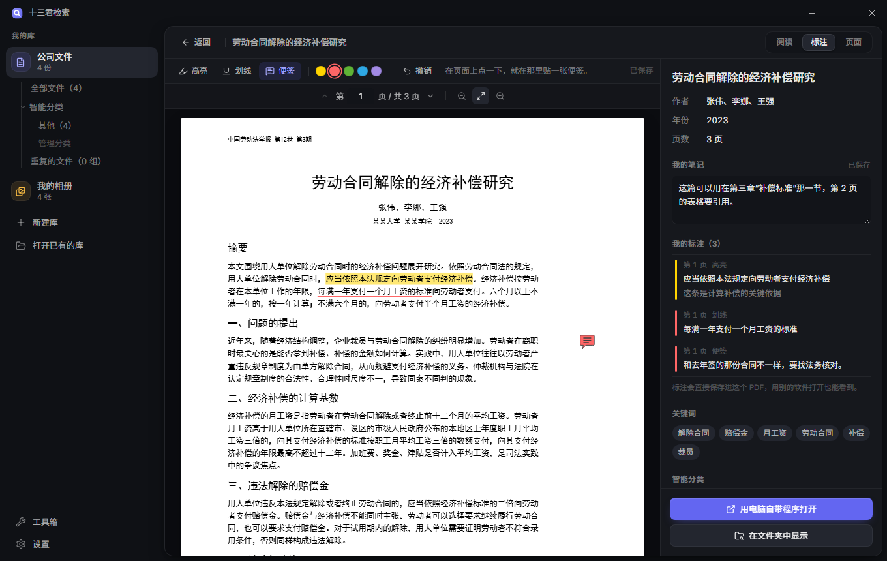
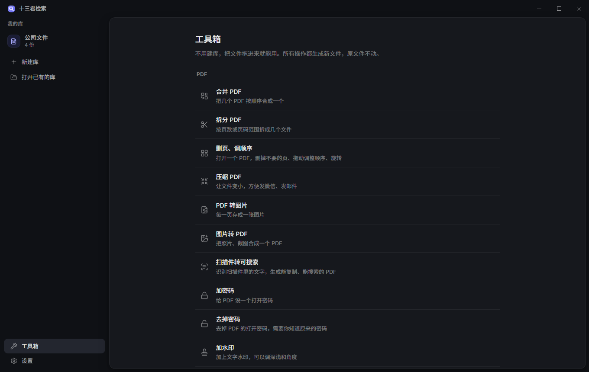
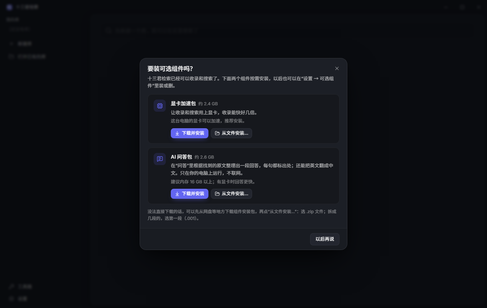

  

  
  
  
  

  <b>把论文、文档、扫描件、照片建成你的私人文献库，用一句话按意思找到原文那一页。</b> 
  智能检索、自动整理，搜索和 AI 都在你的电脑上运行：不用联网、不用注册、资料不上传。

  <a href="https://github.com/accicciva/shisanjun-search/releases/latest"><b>⬇ 下载最新版</b></a>
  &nbsp;·&nbsp; <a href="#能做什么">能做什么</a>
  &nbsp;·&nbsp; <a href="#下载和安装">怎么安装</a>
  &nbsp;·&nbsp; <a href="#常见问题">常见问题</a>

  

## 为什么用它

| | |
|---|---|
| 🔍 **智能检索：按意思找，不用记原话** 搜"被公司辞退能拿多少钱"，也能找到写着"解除劳动合同的经济补偿"的那一页；中文也能搜英文文献，并标出意思最接近的那一句；扫描件、截图里的字也能搜到。 实测：21 篇英文论文用中文提问，全部排进前三。 | 🔒 **完全离线，资料不出电脑** 收录、搜索、AI 问答、翻译都在你的电脑上运行。不用注册账号，断网照样用，资料不会上传。 |
| 🗂 **懒得整理？它帮你整理** 自动按主题分类、找出重复的文件，也可以按你自己的想法分类；想让硬盘上的文件夹也变整齐，一键整理到文件夹（默认复制、可以撤销，原文件不动）。 | 🤖 **本地 AI 帮你读**（可选） 根据找到的原文整理一段回答，每句都标出处，能点回原文核对；英文段落一键翻成中文。AI 也在你的电脑上运行，不联网。 |

**适合谁**：写论文要翻大量文献的研究生；备课、做课题的老师；经常翻法规、制度、合同的上班族；照片多到找不着的摄影爱好者。

> 目前只有中文界面。免费使用，不开放源代码。

## 能做什么

**文本库**（PDF、Word、txt、Markdown，扫描版和截图里的字也认得）
- 智能检索：按意思找，不用记原话。搜"员工离职补偿"，也能找到写着"解除劳动合同的经济补偿"的段落；中文也能搜英文文献，没有关键词可标时，会标出和你要找的内容意思最接近的那一句。
- 点开结果直接跳到原文那一页，命中的地方高亮。
- **问答**：问一个问题，列出能回答它的原文段落，可以全部复制或导出成 Word。
- 装了 AI 问答包以后：根据找到的原文整理一段回答，每句都标出处；英文段落、PDF 里选中的英文可以翻成中文。
- PDF 标注：高亮、便签，写自己的笔记；搜索时可以只看标注过的。

**图片库**（照片、截图、RAW、HEIC）
- 用一句话描述找照片，比如"雪地里穿红衣服的人"；也可以拿一张照片找相似的。
- 拍摄信息、地点、按事件分组；相似连拍只显示一张；找出可能拍糊的照片。

**整理**
- 智能分类、按自己的想法分类、找出重复的文件。
- 整理到文件夹：按分类、日期、事件整理，可以按内容自动改名；默认复制、可以撤销，原文件不动。

**工具箱**（不用建库，拖进文件就能用）
- 合并、拆分 PDF，删页、调顺序，压缩，PDF 和图片互转，扫描件转可搜索，加密码、去掉密码，加水印、加页码。

| | |
|---|---|
|  |  |
|  |  |
|  |  |

## 下载和安装

到 [Releases（发布页面）](https://github.com/accicciva/shisanjun-search/releases/latest) 下载：

| 文件 | 说明 |
|---|---|
| `shisanjun-search-<版本>-setup.exe` | **完整安装包**，第一次安装下载这个（约 1.9 GB）。包含程序和收录、搜索要用的全部文件，装好就能用。 |
| `shisanjun-search-<版本>-update.exe` | 更新包。程序会自己下载、自己安装，一般不用手动下载。 |
| `latest.json`、`latest.json.sig`、`SHA256SUMS.txt` | 程序检查更新用的版本信息和文件指纹，不用下载。 |

如果安装包旁边还有 `setup-1.bin` 这样的文件，要和 setup.exe 一起下载、放在同一个文件夹里再运行 setup.exe。

### 可选组件

程序本身已经可以收录和搜索。下面两个组件按需安装：第一次打开程序时会问你要不要装，以后也可以在"设置 → 可选组件"里装或删。

| 组件 | 大小 | 有什么用 | 适合谁 |
|---|---|---|---|
| 显卡加速包 | 约 2.4 GB | 收录和搜索用上显卡，收录能快好几倍 | 有独立显卡或较新的集成显卡（支持 DirectX 12）的电脑，推荐安装 |
| AI 问答包 | 约 2.6 GB | 问答时整理一段带出处的回答；英文翻成中文 | 内存 16 GB 以上；有显卡时回答更快 |

在程序里点"下载并安装"就行。打不开 GitHub 的话，可以从 [组件下载页面](https://github.com/accicciva/shisanjun-search/releases/tag/packs) 或者别人转给你的网盘下载 `.zip.001` 等文件，放在同一个文件夹里，再在程序里点"从文件安装…"，选第一个文件（`.001`）。安装前程序会核对作者的签名和每个文件的指纹，被改过的文件不会被装上。

## 电脑要求

- Windows 10 或 Windows 11，64 位
- 内存 8 GB 以上（装 AI 问答包建议 16 GB）
- 硬盘：程序约 2.5 GB，每个可选组件约 2.5 GB；库的大小看资料多少，原文件不会被复制
- 显卡不是必须的：没有显卡也能用，只是收录慢一些

## 常见问题

**打开安装包时，Windows 提示"Windows 已保护你的电脑"？**
作者是个人，没有购买代码签名证书，所以会出现这个提示。点"更多信息"→"仍要运行"即可。请只从本页面下载；想确认文件没被改过，可以核对发布页面上 `SHA256SUMS.txt` 里的文件指纹（在 PowerShell 里运行 `Get-FileHash 文件名`）。

**杀毒软件提示有风险？**
这是误报：打包工具生成的程序有时会被误认。请只从本页面下载，必要时把安装位置加入杀毒软件的信任列表。如果确认是从这里下载的还被报毒，欢迎发邮件告诉作者。

**会联网吗？会上传我的资料吗？**
搜索、AI 问答、翻译都在你的电脑上运行，不会上传任何资料。只有三种情况会联网：
1. 检查更新：每天最多一次，只读取一个很小的版本号文件，可以在"设置 → 更新"里关掉；
2. 你点了"下载更新"；
3. 你点了"下载并安装"可选组件。

**资料存在哪里？**
库保存在你新建库时选的位置，一个库就是一个文件夹，可以整个拷走。原文件只是被"引用"，不会被复制或移动（只有你用"整理到文件夹"时，才会按你的选择复制或移动）。

**怎么更新？**
联网时程序会自己检查，有新版本时左下角会提示。点"下载更新"→"安装并重新打开"，程序会关闭十几秒，装好后自动重新打开，库、设置和已经装好的组件都会保留。

**怎么卸载？**
Windows 设置 → 应用 → 十三君检索 → 卸载。可选组件会一起删除；你的库文件夹和原文件不会被删除。

**有英文界面吗？**
目前只有中文界面。搜索可以中英文互相搜到，英文资料也能用。

## 更新日志

### 1.5.1（2026年10月）
- 修复：1.5.0 里点开搜索结果查看原文、使用工具箱里的工具时，页面打不开的问题。**装了 1.5.0 的请尽快更新**（程序里左下角会提示，点"下载更新"即可）。
- 用中文搜英文文献更准了：没有显卡加速时，英文段落也会被完整地比较（实测 21 篇英文论文，用中文提问全部排进前三）。
- 没有关键词可以标出来的摘录（比如用中文搜英文），会用浅色底标出和你要找的内容意思最接近的那一句；问答里的英文段落也一样。
- 修复：英文论文里在行尾断开的单词（比如 perform-ing）没有接起来，显示成方框、也搜不到的问题。以前建的库，可以在"库设置"里点"重新收录这个库"。
- 修复：个别英文论文的标题认错的问题。

### 1.5.0（2026年10月）
- 第一个公开发布的版本。
- 新增 AI 问答包（可选）：问答时根据原文整理一段回答，每句都标出处；英文可以翻成中文。全部在你的电脑上运行。
- 显卡加速包、AI 问答包改为按需安装：可以在程序里直接下载，也可以从下载好的文件安装。
- 联网时自动检查更新。更新只下载程序本身，装好后自动重新打开，库和设置都会保留。
- 新增启动画面；设置里加了反馈邮箱。

## 反馈

遇到问题或有建议，发邮件到 **lingjun1234qq45@2925.com**。
程序里"设置 → 遇到问题？→ 导出问题报告"可以生成一份问题报告，一起发过来能帮助排查。报告里是程序的运行记录和电脑的基本信息（可能包含出问题的文件名），不含文件内容；发送前可以自己打开看看。

## 支持作者

十三君检索免费使用。觉得好用的话，可以用微信扫码请作者喝杯咖啡，完全自愿，不影响任何功能。

## 许可

- 本软件免费提供给个人使用，可以把原版安装包原样转给别人；详见 [用户协议](用户协议.txt)。
- 用到的开源组件及其许可证，见程序里的"设置 → 关于 → 使用的开源组件与许可"，许可证全文随程序一起安装。

## English

**Shisanjun Search (十三君检索)** is a free, offline desktop app for Windows that turns your PDFs, papers, scanned documents and photos into a private, searchable library. It finds passages by meaning rather than exact words (semantic search), works across languages (for example, a Chinese question finds the right passage in an English paper and highlights the closest sentence), reads text in scans and screenshots (OCR), organizes files by topic and finds duplicates, and can optionally answer questions from your documents with citations using a local AI model. No cloud, no account — your files never leave your computer. The interface is Chinese-only for now.
